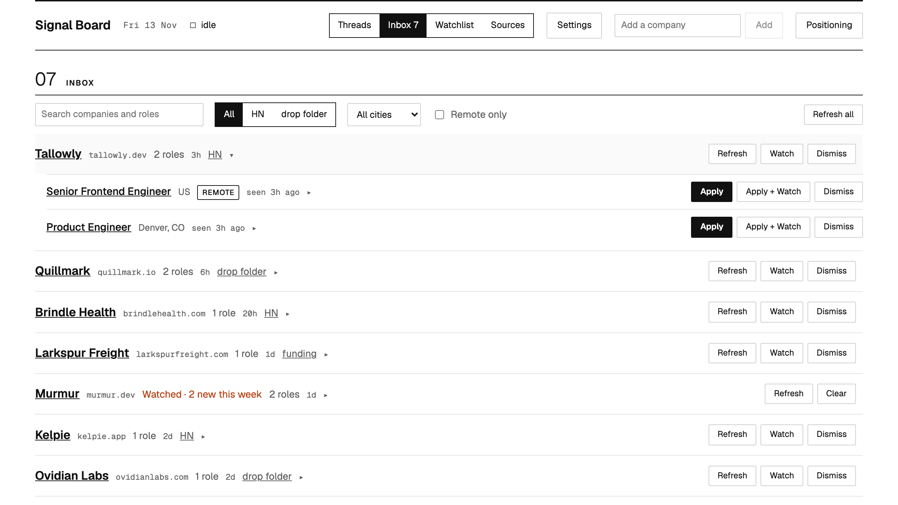
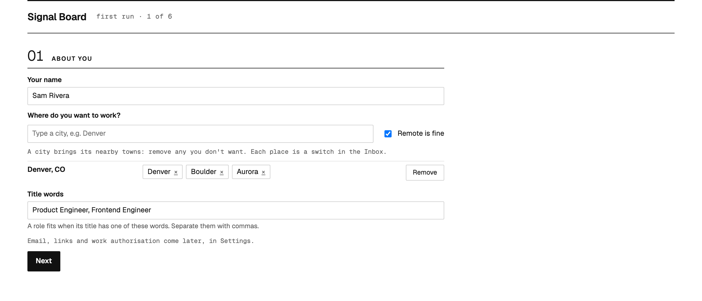
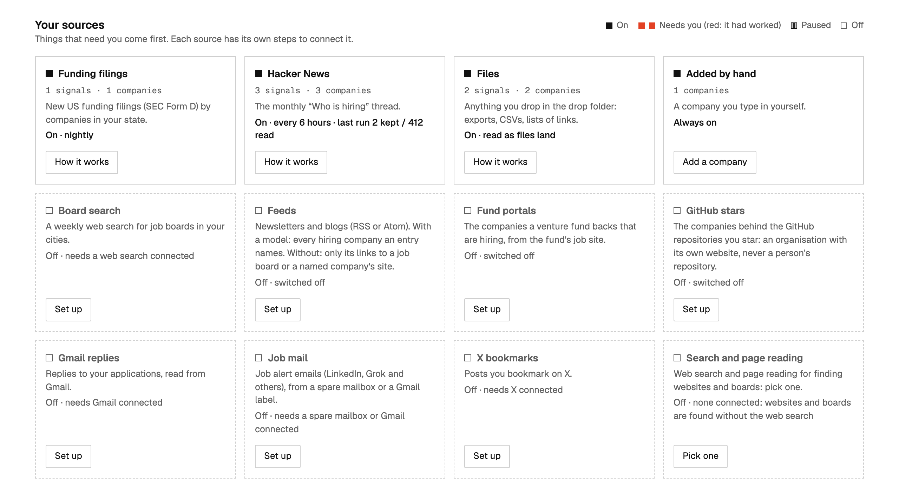
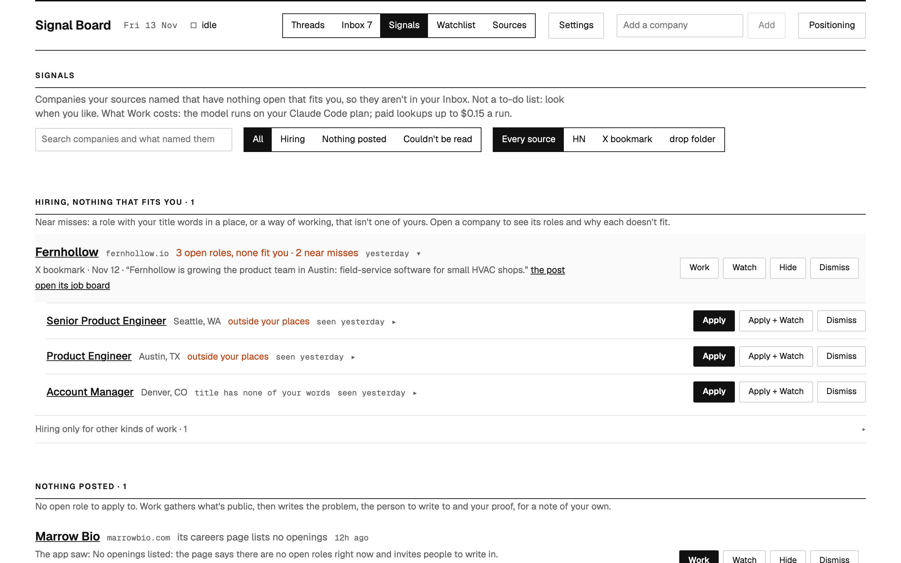
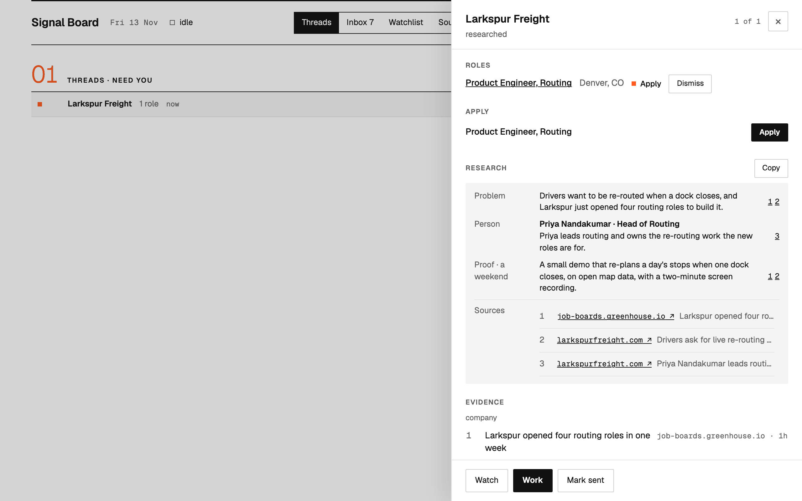

# Job Signal

Job Signal finds companies that are hiring, from places you choose, and shows you the roles that
fit you. You pick the few worth your time. It fills in the application form and helps you find
who to write to. You send everything yourself.

It runs on your Mac. It is a little slow on purpose: a short list of roles you care about, not a
flood of them.



## Install

Open Terminal (press Command and Space, type Terminal, press Return). Paste this line and press
Return:

```sh
curl -fsSL https://raw.githubusercontent.com/alnaik/signals/main/scripts/install.sh | bash
```

What happens next:

1. It installs what Job Signal needs, if your Mac doesn't have it yet: Bun (what Job Signal runs
   on), Claude Code (one way to run the model) and a browser it reads careers pages with.
2. It makes a folder for your data, `JobSignal`, in your home folder.
3. It starts Job Signal in the background and opens it in your web browser.
4. A first run of six short steps sets you up: about you, the model, a search provider, your
   signals, applying, and your positioning. Only the first is needed. Skip the rest and come back
   to them later.
5. You land on **Sources**, which shows what is on and what to set up next.

The background reading starts once you finish the first run.



That is all you need to start. The rest of this page is for when you want to know more.

## How you use it


1. **Signals come in.** A signal is anything that says a company may be hiring: a post in Hacker
   News' monthly "Who is hiring" thread, a job alert email, a funding filing, a company you add
   yourself. You choose which sources are on, and you can add more over time.
2. **Companies are found.** For each company a signal names, Job Signal finds its real website
   and its own job board.
3. **Roles appear.** It reads each board about every 6 hours. Companies with roles that fit your
   title words and places go to your **Inbox**.
4. **You pick.** On each role: **Apply**, **Apply + Watch** (keep its new roles coming) or
   **Dismiss**.
5. **The rest is on Signals.** A company a signal named with nothing open that fits you is on
   **Signals**, with what named it and why it isn't in your Inbox: hiring, but nothing fits (near
   misses first: your title words in a place that isn't yours); nothing posted; or a careers page
   the app couldn't read. **Work** on any of them, **Hide** one from that list, or **Dismiss** it.
   Companies that are likely noise (no website known, a fund, no signal on record) are folded away,
   never deleted.
6. **Apply fills the form.** The form opens in Chrome, filled in from your profile, your earlier
   answers and your CV by the Job Signal extension: the PDF is attached, and its text file, if you
   add one, fills the work history and education. You check it and press Submit yourself.
7. **Work finds who to write to, if you want.** It gathers public facts about the company, each
   with the exact words it came from, and writes a short brief: a problem the company has, the
   person who owns it, and something you could make for them. You write the message. It works on a
   company with no open role too: that is what Work on Signals is for.

**Sources** shows each source, whether it is on, and the steps to connect it:



**Signals**: the companies your sources named that have nothing open that fits you, and why:



**Work** on a company, with every line tied to the facts it rests on:



More: [Getting started](docs/getting-started.md), the screens and what each button does ·
[Sources](docs/sources.md), every source and how to connect it · [How it works](docs/how-it-works.md).

## For the curious

### What runs where

Everything runs on your Mac. The board is a web page that only your Mac can open (it listens on
127.0.0.1, never on your network). A background check runs every 15 minutes, and again when your
Mac wakes. Your data is one folder, `~/JobSignal`: one database file, your profile and CVs, and
one folder per company you acted on. Keys and sign-ins are kept in the macOS Keychain, never in
that folder.

### What leaves your Mac, and to whom

| Who | What they get | When |
| --- | --- | --- |
| Companies' job boards and careers pages | A request for their public job list. Nothing about you. | About every 6 hours per board |
| Hacker News | A request for the public "Who is hiring" thread | Every 6 hours |
| The SEC | Your email address, because the SEC asks every reader of its filings for one | Nightly, if Funding filings is on |
| Anthropic (through Claude Code or your API key) | The text of posts, alert mails and careers pages to sort; for Work, the facts found about that company, your name, your positioning page and your list of evidence. Never your CV. | Only if you connect a model |
| The search provider you pick (Context.dev, Exa, Firecrawl or Parallel), and Hunter if you add it | Company names, websites and search words; for Work, the name of the person to find | Only if you add its key |
| GitHub, X, Gmail, a spare mailbox, feeds and fund job sites | Read-only requests to the accounts and addresses you connect | Only if you connect them |

The form filler in Chrome talks only to Job Signal on your Mac. Your CV goes only into the forms
you open. Your north star, the sentence in the board's margin, never leaves your Mac.

### What it costs

Free with nothing connected: Hacker News, job boards, funding filings, files you drop in and
companies you add. A Claude subscription runs the model at no extra cost; an Anthropic API key
is paid per use. Each search provider has a free allowance. Paid lookups stop at a monthly limit
you set ($5 to start). Details: [docs/spend.md](docs/spend.md).

### The rules it keeps

- **Nothing is sent for you.** No form is submitted and no message is sent by Job Signal.
- **robots.txt is honoured.** A site that asks not to be read is not read. Exceptions can only be
  added by you, in `config.toml`, each with a reason.
- **LinkedIn pages are never read**, and it never applies on LinkedIn. LinkedIn job alerts come in
  as email.
- **A form for another company than the one you opened is not filled without asking.** If the
  page moves on to another company's form, nothing goes in until you press Fill on the notice.
- **Voluntary questions are never answered for you**: gender, race, veteran status, disability.
  Work authorisation and sponsorship are filled only from your own answers in Settings.
- **Keys stay in the Keychain.** The bug report names a key only as set or not set.
- **Nothing on your own network is read.** Every address, each redirect included, is checked to
  be a public one first. Known limit: outside the job board readers, a site's name is looked up
  once for the check and again for the request, so a site that switches its address between the
  two could get past it.
- **Every claim has a source.** Each fact Work uses carries the exact quote from its page. A
  line that cites no fact is shown greyed.

### Requirements

- A Mac (macOS). Job Signal runs on macOS only.
- Git. If the installer says it is missing, run `xcode-select --install` in Terminal, then the
  install line again.
- Bun and Claude Code: the installer adds them if they are missing.
- Google Chrome, for the form filler. Without it, Apply still opens the form, just not filled in.
- Optional: a Claude subscription or an Anthropic API key, for the model steps (sorting posts,
  reading some careers pages, Work). Without one, those steps wait and Sources says so.

### Update and uninstall

To update, paste the install line again. Your data folder is kept.

To uninstall, in Terminal:

```sh
cat ~/.jobsignal 2>/dev/null || echo ~/JobSignal       # where your data folder is: note it first
~/.local/bin/jobsignal schedule uninstall              # stop the board and the background check
rm -rf ~/.jobsignal-app ~/.local/bin/jobsignal ~/.jobsignal
```

The first line matters only if you moved your data folder at first run: `~/.jobsignal` remembers
where it is, and the last line removes it. Then, if you want them gone too: delete that data folder
(your data), remove the keys in Keychain Access (search for "jobsignal"), remove the extension at
`chrome://extensions`, and delete the browser used to read pages, `~/Library/Caches/ms-playwright`
(unless something else of yours uses Playwright). Bun and Claude Code stay installed.

### When something breaks

The board shows **Problems**. **Copy bug report** copies a report you can paste into an issue or
into Claude Code. It names keys only as set or not set and holds none of your profile.

### Docs

- [Getting started](docs/getting-started.md): first run, each screen, the commands
- [How it works](docs/how-it-works.md): from a signal to an application, the model's limits, where
  data lives, for contributors
- [Sources](docs/sources.md): every source and how to connect it
- [Spend](docs/spend.md): what each step costs and the limits
- [Gmail](docs/gmail-setup.md): connecting Gmail for replies
- [Intake rules](docs/intake-rules.md): every rule from a signal to a role, in full
- [Security](SECURITY.md) · [Contributing](CONTRIBUTING.md)

### For developers

Personal data lives in the data folder (default `~/JobSignal`, or `JOBSIGNAL_DATA`), never in the
repo.

```sh
bun ci                 # install exactly what bun.lock says
bun run check          # lint, typecheck, tests
bun bin/jobsignal.ts   # list commands
```

### Credits and licence

Job Signal is MIT licensed ([LICENSE](LICENSE)). It includes the job board readers of
[career-ops](https://github.com/career-ops-hq/career-ops) (MIT, `vendor/career-ops/LICENSE`) and
the [Geist](https://vercel.com/font) fonts (SIL Open Font License, `board/fonts/OFL.txt`).
