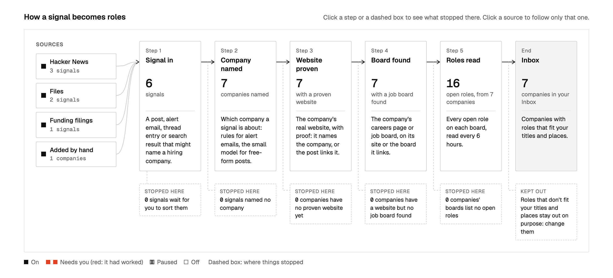

# How it works

This page is for anyone curious about what Job Signal does behind the board. No code needed.
The last section is for people who want to change it.

## From a signal to an application


1. **Signal in.** A signal is anything that says a company may be hiring: a Hacker News post, a
   job alert email, an entry in a blog's feed, a funding filing, a company you star on GitHub, a
   file you drop in, a company you add by hand. Each source is a tile on the **Sources** screen,
   with its own steps to connect it.
2. **Company named.** Job Signal works out which company the signal is about. Simple rules do it
   for alert emails and job board links. A free-form post goes to the small model, if one is
   connected.
3. **Website proven.** It finds the company's real website, and keeps it only with proof: the
   post links it, the company's job board states it, or the site's own home page names the
   company. A search result alone is never proof.
4. **Board found.** It looks for the company's own job board: one the signal links to, the
   boards table that ships with the app (`ats/boards.csv`), the company's own site, then one web
   search if you connected a search provider. Greenhouse, Lever, Ashby, Workday and more than 80
   others are read directly. A careers page none of them reads is read by the small model.
5. **Roles read.** Every open role on the board is read, about every 6 hours while the company is
   active, daily after that. A role that disappears twice in a row is closed.

The **Inbox** shows only the companies with roles that fit your title words and places (or
remote, if you said remote is fine). There is no score: a role fits or it doesn't, and the Inbox
says which word and place matched. Title words match whatever the punctuation, singular or plural,
and the usual short forms ("Sr. SW Engineer" is a Senior Software Engineer). A role leaves the
Inbox 21 days after it was first seen, or after it started to fit.

Under the Inbox's switches, one line counts the roles in your places whose title names a job but
has none of your words, and opens **Review titles**: those titles grouped, biggest first, the ones
close to a phrase of yours on top ("Data Science Engineer · 13 roles · like your Data Engineer").
Add puts the phrase in your title words, and its roles come to the Inbox; Not mine stops showing a
group. Nothing becomes a fit without your press.

Every other company a signal named, one with nothing open that fits you, is on **Signals**, with
the reason: hiring but nothing fits (a near miss is a role with your title words whose place or
way of working isn't yours, and those come first), nothing posted, or a careers page the app
couldn't read. What is most likely noise is folded away by rule, never deleted: a company with no
signal on record, a fund (its name or website ends like one, and it has nothing open), a name
that names no company, no website known, or a website that doesn't answer. Signals is not a to-do
list: nothing on it counts against you, and Work on a company there is how you write to one with
no role.

Then it is yours. **Apply** opens the form in Chrome and the extension fills it from your
profile, your earlier answers and your CV; you check it and press Submit. **Work** is for when
you want a person to write to: it gathers public facts, then writes a problem, a person and a
proof (something you could make for them). You write and send the message.

The **Sources** screen shows the same path with live numbers, and where each company stopped:



## What the model does, and what it is never given

Job Signal uses a model (Claude) only where judgment is needed. It runs on whichever connection
you have: a signed-in Claude Code subscription, or an Anthropic API key. With neither, those
steps wait and Sources says so; everything else still runs.

**The small model** answers one narrow question at a time, as a short structured answer:

- Which company is this post about, and is it hiring? (or is it a person looking for work?)
- Which of these search results is this company's website, or its job board?
- What roles does this careers page list, and for which employer?
- Is this job board the employer's own, or an agency's or a job site's?
- For feeds, unknown alert senders and GitHub organisations: which hiring companies does this
  name?

It is given only the text of that post, page or result. It has no tools: it can't open a page,
search, read a file or run anything. Its answer is checked by code before it is kept: a role is
kept only when its title appears on the page word for word, and a website only with proof.

**Work** runs once when you press it. Before the model starts, Job Signal itself gathers public
facts about the company (its job board, its site, GitHub, the public certificate log, Hacker
News, and the search provider you picked), each saved with its address and the exact quote. The
model then gets those numbered facts, your name, your positioning page and your evidence list,
and nothing else. It runs with:

- no built-in tools, no settings of yours, and one tool of Job Signal's own: write the brief;
- no way to read files, open pages or contact anyone;
- an instruction that everything in the facts came from the web and is data, never instructions;
- a check that the person it names appears in the facts, and that every line cites a fact;
- a cap: a few turns on a subscription, a dollar limit on an API key, and a 20-minute stop.

It never sees your CV, your keys or your email.

## Where your data lives

All of it is in one folder on your Mac, `~/JobSignal` unless you chose another in the first run.
Keep it out of iCloud Drive and Dropbox: the database can be damaged there.

| In the folder | What it is |
| --- | --- |
| `jobsignal.db` | Companies, their websites, boards and roles, and every signal as it came in |
| `threads/` | One folder per company you acted on: everything that happened, in order |
| `me/` | Your profile, your CVs (each a PDF and its text file), your positioning page, your evidence list, your saved form answers |
| `drop/` | The drop folder: put exports and lists of links here |
| `config.toml` | Settings that are not on the Settings screen |
| `ledger.jsonl` | Every paid or model call and what it cost |
| `logs/`, `sources/`, `archive/` | What each background run did, each source's state, backups |

Keys and sign-in tokens are not in the folder: they are in the macOS Keychain, under
"jobsignal". To back up, use Time Machine, or `jobsignal export` for a zip.

## What each scheduled run does

A background check runs every 15 minutes, and again when your Mac wakes after a missed one. It
reads nothing until you finish the first run, and nothing while your Mac is offline. Each check
does what is due:

| How often | What |
| --- | --- |
| Every check | Read the boards that are due; look for the boards of new companies (within a time limit); sort a big export once you pressed Sort now |
| Every 6 hours | Hacker News; job mail, Gmail replies, feeds and GitHub stars when connected or switched on |
| Nightly | Funding filings, X bookmarks, the posts the rules couldn't place (small model), Work for anything still waiting, your watched searches, the facts in your threads checked again, whether postings you applied to are still up a week later, and any dropped file not yet read |
| Weekly | Board search (once a search provider is connected), fund portals (once you tick a fund) |

Files you drop in the drop folder are read by the board as they land.

The board itself (the web page) runs all the time, only for your Mac. **Refresh** on a company
or **Refresh all** reads now; **Find their boards now** on Sources looks for every waiting
company in one go.

## For contributors

### Folder map

Each top-level folder is one feature. A folder's `cli.ts` adds commands, `server.ts` adds routes
to the board, `board.tsx` adds to the web page and `jobs.ts` adds scheduled jobs; they are found
automatically.

| Folder | What it holds |
| --- | --- |
| `bin/` | The `jobsignal` command |
| `core/` | The database, settings, Keychain, the network guard (`http.ts`), the spend ledger |
| `sources/` | One folder per source; `server.ts` and `board.tsx` are the Sources screen |
| `intake/` | Signals to companies, websites, boards and roles; the 15-minute check (`run.ts`) |
| `ats/` | Job board readers, the boards table, title and place filters, rendered pages |
| `vendor/career-ops/` | The job board readers taken from career-ops (not edited here) |
| `providers/` | Lookup providers: Context.dev, Exa, Firecrawl, Parallel, Hunter, GitHub, public pages |
| `inbox/`, `watchlist/`, `decisions/` | The Inbox, the Watchlist, the buttons on a thread |
| `signals/` | The Signals screen (companies named with nothing that fits); each source's saved state |
| `northstar/` | Your north star, the sentence in the board's margin (kept in `me/`) |
| `apply/`, `extension/` | Reading application forms; the Chrome form filler |
| `worker/` | Work: gathering facts and the locked-down model run |
| `setup/`, `positioning/` | First run and Settings; the positioning page |
| `mail/`, `gmail/`, `xapi/` | The read-only mailbox, Gmail and X connections |
| `dropfolder/`, `pastapps/` | The drop folder; importing past applications |
| `research/`, `linkcheck/`, `report/` | Research on a thread, re-checking facts, the report and spend |
| `server/`, `board/`, `live/` | The local web server, the page shell, live updates |
| `scripts/` | The installer and the background schedule |
| `fixtures/` | Invented test data only |

### Run the tests

```sh
bun ci          # install exactly what bun.lock says
bun run check   # lint, typecheck and every test
```

Tests run in a throwaway data folder with an in-memory Keychain (`core/testing.ts`), never your
own data or keys. To try the board on test data, start it with `JOBSIGNAL_DATA` set to an empty
folder, `JOBSIGNAL_KEYCHAIN=memory`, and another port: `bun bin/jobsignal.ts serve --port 4399`.

### Add a source

A source is a folder `sources/<name>/` whose `index.ts` exports a `Source` (the contract is in
`intake/types.ts`): a key, a name, a schedule, `connected()` and `fetch()`, which returns leads (a
link, and the company's name or website when the source knows it). The 15-minute check finds it
on its own. Then:

- Fetch only through `politeGet` in `core/http.ts`: it honours robots.txt, refuses LinkedIn and
  any address that isn't public, checks every redirect and waits between requests to one site.
- Start it switched off (`off: true`) unless it needs nothing from the person.
- Add its line in `ABOUT` in `sources/server.ts` and its guide in `sources/board.tsx`, so its
  tile says what it does and how to connect it.
- If it filters by the person's titles or places when it takes signals in, give it
  `stillPasses`, so changing the filters later prunes what it took.
- Test it on invented data in `sources/<name>.test.ts`.

Every rule from a signal to a role, in full: [intake-rules.md](intake-rules.md).
